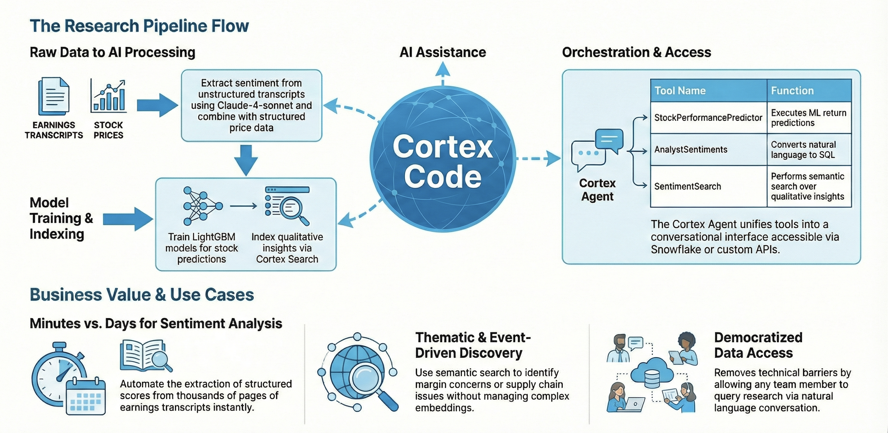

id: quantitative-research-with-ai-functions-and-cortex-code
language: en
summary: Build an AI-powered quantitative research pipeline using Cortex Code, Cortex AI Functions, ML Model Registry, and Snowflake Intelligence to transform earnings call transcripts into actionable investment insights.
categories: snowflake-site:taxonomy/industry/financial-services, snowflake-site:taxonomy/product/ai, snowflake-site:taxonomy/product/analytics, snowflake-site:taxonomy/snowflake-feature/ingestion/conversational-assistants, snowflake-site:taxonomy/snowflake-feature/cortex-llm-functions, snowflake-site:taxonomy/snowflake-feature/cortex-analyst, snowflake-site:taxonomy/snowflake-feature/cortex-search, snowflake-site:taxonomy/snowflake-feature/snowflake-intelligence, snowflake-site:taxonomy/snowflake-feature/marketplace-and-integrations, snowflake-site:taxonomy/snowflake-feature/snowpark, snowflake-site:taxonomy/snowflake-feature/cortex-code
environments: web
status: Hidden
authors: Harry Yu, Serena Zou, Dureti Shemsi
feedback link: https://github.com/Snowflake-Labs/sfguides/issues
fork repo link: https://github.com/Snowflake-Labs/sfguide-quantitative-research-aisql-cortex

# Quantitative Research with AI Functions and Cortex Code using Snowflake Public Data

## Overview

This guide demonstrates how to build an end-to-end AI-powered quantitative research pipeline using Snowflake's native AI capabilities—with **Cortex Code** as your AI coding assistant throughout the journey.

Financial analysts spend countless hours manually reviewing earnings call transcripts to gauge market sentiment and identify investment opportunities. This guide automates and scales that process while showing you how to use **Cortex Code** to build, understand, and extend the solution through natural language conversation.

Using publicly available earnings call data from Dow Jones 30 companies (via Snowflake Marketplace), this guide walks you through extracting sentiment with Cortex AI Functions, building predictive ML models with Cortex Code, and creating an intelligent conversational agent accessible through Snowflake Intelligence.

## Build with Cortex Code

**Cortex Code** is an AI-driven intelligent agent integrated into the Snowflake platform, optimized for complex data engineering, analytics, machine learning, and agent-building tasks. It uses an autonomous agent framework to interact directly with your Snowflake environment, with deep understanding of Snowflake's Role-Based Access Control (RBAC), schemas, and best practices.

**Available in two interfaces:**
- **Snowsight** - Click the Cortex Code icon (bottom-right corner) in Notebooks or Workspaces. Generate code from natural language, explain and optimize existing queries, review AI-suggested changes with diff views before applying.
- **CLI** - For power users and developers, the Cortex Code CLI provides an agentic shell that bridges your local development environment (VS Code, Cursor) and your Snowflake account. It can read/write local files, execute SQL, run bash commands, and manage dbt projects or Streamlit apps.

**What makes this guide unique:** Rather than just running pre-built notebooks, you can use Cortex Code to build the entire ML pipeline through conversation—from feature engineering to model training, backtesting, and registration in the Snowflake ML Registry.

## Key Features

**AI-Powered Sentiment Extraction**: Use Cortex AI Functions's `AI_COMPLETE()` function with Claude (`claude-4-sonnet`) to analyze earnings call transcripts and extract structured sentiment scores (1-10 scale), analyst participation counts, and human-readable reasoning—all from unstructured text.

**Momentum-Based ML Predictions**: Train LightGBM models on technical momentum features using walk-forward quarterly validation, then register them in Snowflake's ML Model Registry for production inference.

**Semantic Search Over Sentiment**: Create Cortex Search services that enable natural language queries like "find companies with margin concerns" or "show bullish analyst sentiment"—without managing embeddings or vector databases.

**Natural Language Analytics**: Build semantic views for Cortex Analyst that allow business users to query sentiment data with plain English questions like "Which companies have the highest analyst sentiment?"

**Unified Conversational Interface**: Deploy a Cortex Agent that combines text-to-SQL (Cortex Analyst), semantic search (Cortex Search), ML predictions (stored procedures), and email notifications into a single chat experience via Snowflake Intelligence.

## How It Works

This guide leverages Snowflake's native AI features to create a seamless, end-to-end workflow without the need for external tools or data movement.

**Data Foundation**: Earnings call transcripts from DOW 30 companies are sourced from Snowflake Marketplace's free public data. Stock price data is pre-computed into momentum features for ML training.

**Sentiment Extraction**: The `AI_COMPLETE()` function processes each transcript with Claude, extracting structured JSON responses containing sentiment scores, analyst counts, and reasoning explanations.

**Model Training**: LightGBM regressors are trained on momentum ratios to predict forward stock returns. Models are versioned and deployed through Snowflake's ML Model Registry, making predictions available as SQL functions.

**Cortex Search Services**: Sentiment reasons are indexed into Cortex Search, enabling semantic retrieval across all analyzed transcripts. Analysts can find relevant insights using natural language queries.

**Cortex Analyst**: A semantic view defines the relationships and metrics within sentiment data, making it easy for the AI to understand and respond to analytical questions about sentiment trends and distributions.

**Cortex Agents**: A single agent is created with role-specific instructions that orchestrate multiple tools—ML predictions, text-to-SQL queries, semantic search, and email notifications—based on user intent.

**Snowflake Intelligence**: The conversational interface where users interact with the Cortex Agent. Users can ask complex multi-step questions, and the agent coordinates the appropriate tools to provide comprehensive answers.

## Architecture

The architecture shows how Cortex Code serves as the central AI coding assistant throughout the pipeline—from data ingestion using **Snowflake Public Data (Free)** from Snowflake Marketplace, to sentiment extraction with Cortex AI Functions, ML model training and registry, and finally the unified agent experience in Snowflake Intelligence.

## Business Impact

This guide helps quantitative research teams transition from manual transcript analysis to automated, AI-driven insights:

**Faster Analysis**: Extract sentiment from dozens of earnings calls in minutes instead of days. What previously required reading thousands of pages can now be summarized with a single query.

**Scalable Coverage**: Expand coverage from a handful of companies to the entire DOW 30 (or beyond) without adding headcount. AI handles the extraction while analysts focus on interpretation.

**Consistent Methodology**: Apply the same sentiment scoring criteria across all transcripts, eliminating analyst-to-analyst variation and enabling apples-to-apples comparisons.

**Predictive Insights**: Combine qualitative sentiment with quantitative momentum factors to identify potential alpha opportunities before they're priced in.

**Instant Access**: Any team member can query sentiment data or run predictions through natural language, democratizing access to research insights.

## Use Cases and Applications

This guide serves as a blueprint for AI-powered quantitative research:

**Sentiment Analysis**: Extract structured sentiment scores from unstructured earnings call transcripts, tracking analyst reactions and management tone over time.

**Stock Screening**: Use ML predictions to rank stocks by expected returns, combining technical momentum with fundamental sentiment signals.

**Event-Driven Research**: Quickly assess how analyst sentiment shifted after specific corporate events, earnings surprises, or market moves.

**Thematic Discovery**: Search across all transcripts for mentions of specific themes—supply chain issues, margin pressures, competitive threats—using semantic search.

**Automated Reporting**: Generate email summaries of top stock picks, sentiment changes, and notable transcript excerpts without manual compilation.

**Cross-Sectional Analysis**: Compare sentiment across sectors, market caps, or time periods using natural language queries against the semantic view.

## Agent Capabilities

| Tool | Type | Description |
|------|------|-------------|
| **StockPerformancePredictor** | Stored Procedure | Generates ranked stock predictions using the registered LightGBM model |
| **AnalystSentiments** | Cortex Analyst | Natural language queries over sentiment data via semantic view |
| **SentimentSearch** | Cortex Search | Semantic search over sentiment reasons and qualitative insights |
| **SendEmail** | Stored Procedure | Sends HTML-formatted email summaries of findings |
| **data_to_chart** | Built-in | Generates visualizations from query results |

## Get Started

Ready to transform your quantitative research workflow? This guide includes everything you need to get up and running quickly.

**[GitHub Repository →](https://github.com/Snowflake-Labs/sfguide-quantitative-research-aisql-cortex)**

## Related Resources

- [Cortex Code Documentation](https://docs.snowflake.com/en/user-guide/cortex-code/cortex-code)
- [Cortex AI Functions Documentation](https://docs.snowflake.com/en/user-guide/snowflake-cortex/aisql)
- [Cortex Search Overview](https://docs.snowflake.com/en/user-guide/snowflake-cortex/cortex-search/cortex-search-overview)
- [Cortex Analyst Guide](https://docs.snowflake.com/en/user-guide/snowflake-cortex/cortex-analyst)
- [Snowflake Intelligence Overview](https://docs.snowflake.com/en/user-guide/snowflake-cortex/snowflake-intelligence)
- [Snowflake ML Model Registry](https://docs.snowflake.com/en/developer-guide/snowflake-ml/model-registry/overview)

